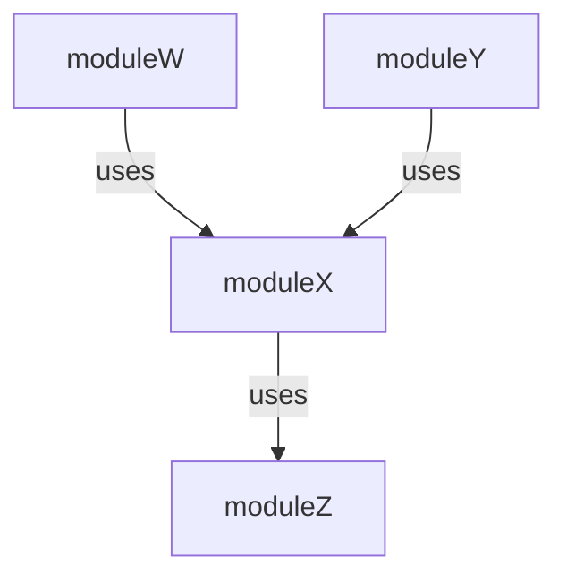

# Modularisation

`Modularisation` is a basic principle of software engineering (or ‘programming-in-the-large’) – the decomposition of a complex system into simpler parts (or ‘modules’) that cooperate and are integrated with one another.  

There are two main kinds of software module:
- **special-purpose modules**, constructed for a specific application
- **general-purpose modules**, typically archived in software <mark>libraries</mark>. 

There are two main ways of designing a modular software architecture:
- **top-down refinement**
- **bottom-up aggregation**.

----

Back up to: [Maglocvnus](../index.md)
