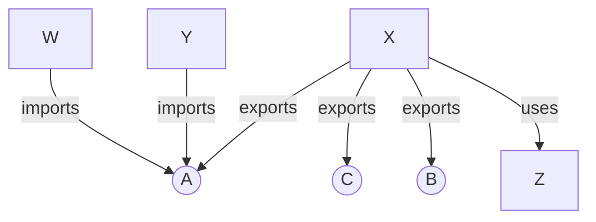

# Modularisation

`Modularisation` is a basic principle of software engineering (or ‘programming-in-the-large’) – the decomposition of a complex system into simpler parts (or ‘modules’) that cooperate and are integrated with one another.  

There are two main kinds of software module:
- **special-purpose modules**, constructed for a specific application
- **general-purpose modules**, typically archived in software <mark>libraries</mark>. 

There are two main ways of designing a modular software architecture:
- **top-down refinement**
- **bottom-up aggregation**.

The following diagram represents a modular software system:

In this diagram:
- X, Y, Z, W are software **modules**.
- A, B and C are software **resources** – functions, variables, data types etc.
- A module **exports** certain resources, making them available to be re-used by other modules.
  - Here, module X exports resources A, B and C.
- The set of resources exported by a module are collectively known as its **interface**.
  - Here, resources A, B and C together form the interface of module X.
- A module can **import** a resource which is exported by another module. In other words, a module can **use** another module.
  - Modules Y and W import resource A from module X.
  - Module X uses module Z.

Some principles of good modularisation:
- **information hiding**:
  - The interface of a module must be very carefully separated from its body.
  - The interface should not expose too much or too little information.
- **low coupling** and **high cohesion**:
  - Resources that are often used together should be in the same module.
  - Resources that are rarely used together should be in different modules.
- **design-for-change**:
  - Modules should be designed from the outset with possible future changes in mind.

----

Back up to: [Maglocvnus](../index.md)
